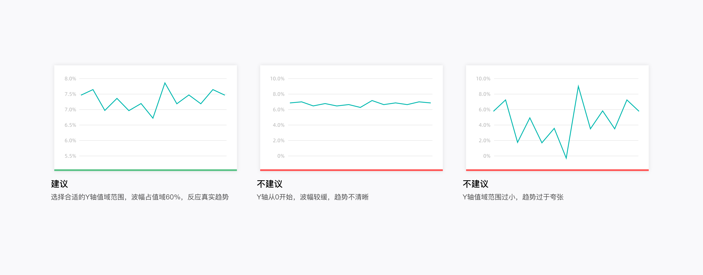
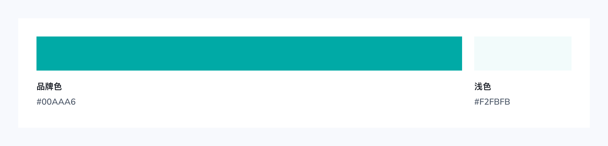
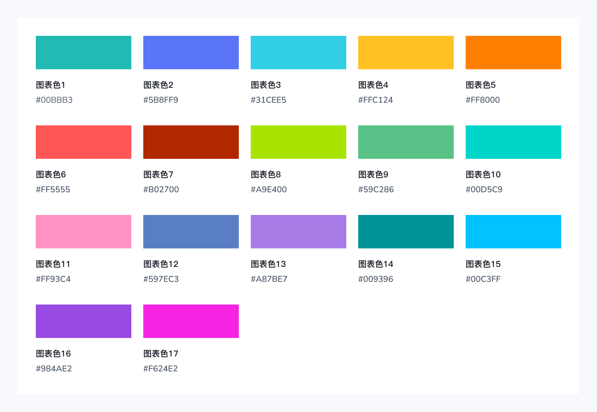
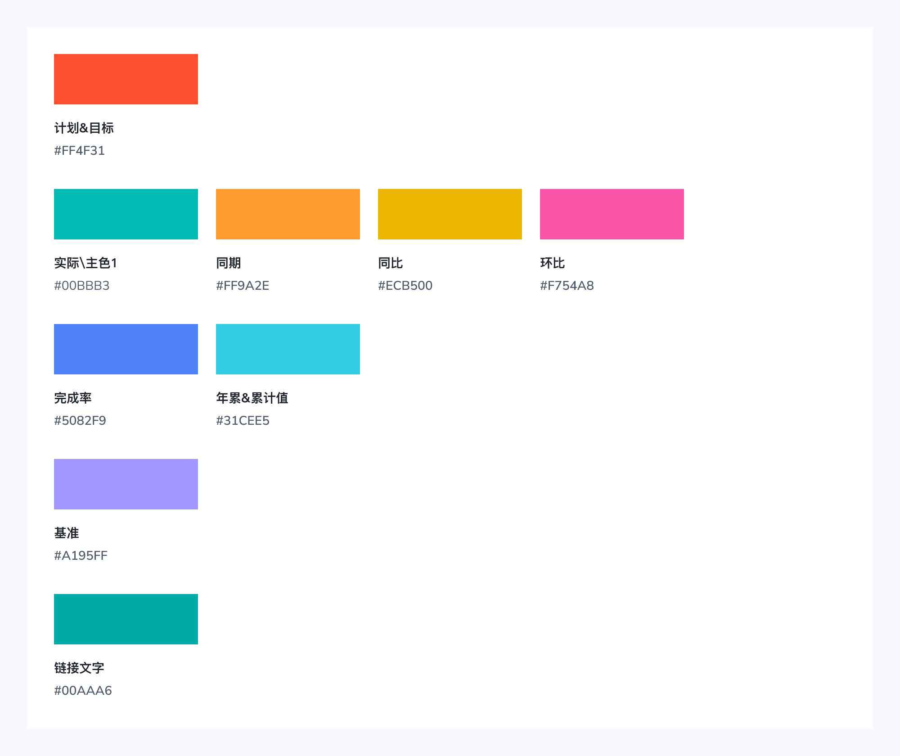
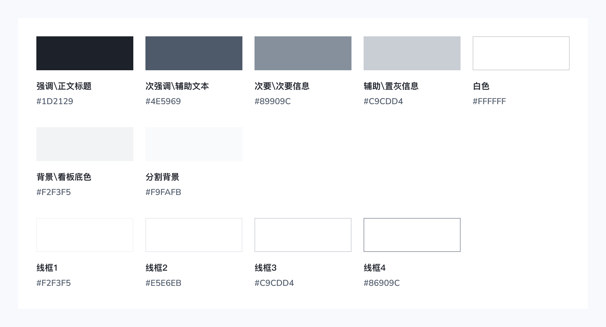
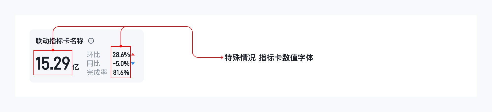

# 集团报表规范文档

# 1 设计原则 

### 1\.1概述

> 核心守住 5 大原则：**准确、清晰、有效、舒适、一致**。
> 
> 

1. **准确**：图表、色彩不能歪曲真实业务，不能误导决策；

2. **清晰**：视觉层次分明，看得懂、分得清；

3. **有效**：突出重点，拒绝信息过载，只展示有用信息；

4. **舒适**：配色柔和自然，视觉体验连贯；

5. **一致（跨部门最重要）**：同一个指标固定一套颜色；涨跌、预警语义颜色全集团统一；所有报表的口径、单位、格式、交互方式全部保持一致，避免不同部门报表对照时产生混淆。

### 1\.2准确

可视表达时不歪曲，不误导，不遗漏，精准如实反应数据的特征信息。例：家电收益率趋势图，合理的值域区间可以反映真实的数据波动趋。

### 1\.3清晰

**结构清晰：**数据可视化呈现的是一幅作品，它是制作者分析思路的呈现，其布局决定阅读者的浏览顺序。清晰的平面布局以及清晰的数据纵深路径能很好的帮助阅读者获取信息。下图展示一个经典的仪表盘设计布局，上方的筛选区从顶层决定画布区呈现的数据，右侧区默认展示画布区的汇总信息，画布上激活数据点时，右侧则更新显示明细数据。

**内容清晰：**不让用户带着疑惑看图是我们始终不变的追求。当图上有数据日期、数据来源、数据指标需要说明时，应当在恰当的时间、合适的位置给予说明，以帮助阅读者更好地理解数据、定位问题。

### 1\.4有效

信息传达有重点，克制不冗余，避免信息过载，用适量的油墨比（Data\-ink Ratio）表达对用户最有用的信息。

### 1\.5一致

同一指标始终使用同一颜色，涨跌等语义色含义全局统一，且口径、单位、格式在所有报表中保持一致。

# 2 设计语言

## 2\.1 概述

以集团现有系统基础样式为基线，不做额外视觉创意。遵循**简洁、统一、数据优先**的核心思路，复用标准化组件、固定字体、色彩与间距规则，弱化装饰元素，保证页面可读性、操作一致性。

所有自研报表统一这套基础视觉与交互语言，减少开发自定义样式，降低用户认知成本，让用户聚焦数据本身，同时保障报表可维护性与跨浏览器展示稳定。

## 2\.2 布局

**以报表为例：**报表页面基准画布宽度默认参考1440px，统一采用必须遵循的 24 列栅格系统。 页面左右内容安全边距默认参考12px，栅格槽宽（gutter）默认参考12px。

**以大屏为例：**大屏页面基准画布宽度默认参考 1920px，强制使用 24 列栅格系统。页面左右内容安全边距默认参考 12px，栅格槽宽（gutter）默认参考 12px。栅格采用 CSS Grid fr 弹性单位均分实现。

示例
可以根据实际情况变 报表内容变动  槽宽以4的倍数为准

## 2\.3 颜色

### 品牌色

### 图表色

图表色不做顺序排列，需参考实际样例布局

### 业务语义色

### 语义色

默认红色代表指标向好改善，蓝色代表指标恶化变差，适用于正向指标。针对反向指标，颜色逻辑自动反转，且页面标注反向属性。

### 中性色

## 2\.4文本

页面UI设计时，为了保证设计稿的一致性，我们推荐文本字体使用 `Pingfang SC-Regular`、`Pingfang SC-Semibold`，数字字体使用`D-Din pro-Regular`、`D-Din pro-Semibold`进行设计。

页面开发实现的时，中文和英文字体使用系统font\-family字体，特殊情况如指标卡数值字体可使用设计稿指定字体`D-Din pro`。

|**类别**|**设计**|**开发**|
|---|---|---|
|中文字体|Pingfang SC|font\-family：PingFang SC,Microsoft YaHei,Helvetica Neue,Helvetica,Hiragino Sans GB,SimSun,sans\-serif|
|英文字体|Pingfang SC|font\-family：PingFang SC,Microsoft YaHei,Helvetica Neue,Helvetica,Hiragino Sans GB,SimSun,sans\-serif|
|指标数值字体|[D\-DINpro字体安装包\.zip](图片和附件/D-DINpro字体安装包.zip)|font\-family：D\-DIN\-PRO\-600\-SemiBold|

### 2\.4\.1字号

考虑到通用性和包容性，在字号的选择上，我们将主字号定义为14px，并提供了不同层级的字号以适配不同信息层级的展示需求。

- 最小可识别文字尺寸：`桌面端：12px` / `移动端：10px`

- 字体层级：区分文本主副层级，字号差距需保持2\-4px

### 2\.4\.2字重

字重是重要排版的变量，可以增强层次结构和重要内容区分。

常规\-Font\-weight: 400 ，加粗\-Font\-weight: 600

字重400是Windows和macOS系统下的Regular显示效果，字重600是Windows系统下的Bold显示效果和macOS系统下的Semibold显示效果。

### 2\.4\.3行高

固定 1\.5 倍的行高比例，在当字号越大的时候，行高就会越大，在大号文字的展示上信息的连贯明显得出现割裂，尤其在多种字号及元素混排的场景中。

### 2\.4\.4段落间距

段落文本中文字的可读性，由字号、行高和段间距的变量决定。在文字较多的内容中，段落与段落之间需要有一定的间距以保证最好的显示效果。根据 WCAG 中的 AAA 标准，段落间距至少为字体大小的 1\.5 倍。正文 14px 字号对应段间距为 22px。

# 3 基础组件应用

## 💻PC端

### 3\.1筛选栏

筛选器是一种通过设定过滤条件和排序方式筛选数据的容器，固定于内容区顶部，便于对报表数据的筛选查看。

#### 3\.1\.1构成

由日期选择器、选择器、选择按钮、常规按钮、展开收起按钮等构成。

|序号|构成元素|说明|
|---|---|---|
|1|时间选择器|对日、周、月、年进行时间的的筛选|
|2|选择器|承载所选选项的容器，同时也是下拉面板的触发器|
|3|选择按钮|单个选项的选择|
|4|展开收起按钮|选择器在一排展开不开的时候，有展开收起状态，以便看到更多的选项，位于常规按钮的左侧|
|5|常规按钮|对选择选器等进行操作，位于筛选器栏的右侧|

#### 3\.1\.2筛选栏尺寸

筛选栏宽度为父容器的100%，单个筛选下拉框高度参考32px。

#### 3\.1\.3筛选栏类型

（下样例参考）

### 3\.2标题栏

大标题直观告知用户当前页面核心内容，帮助快速定位页面主题；指标更新时间让用户明确数据的新鲜度，也增强了用户对数据可靠性的感知。

#### 3\.2\.1构成

组件由大标题、业务说明图标、更新时间组成。

|序号|构成元素|说明|
|---|---|---|
|1|大标题|位于标题栏左侧，字号为16px，字重Semibold，颜色为【强调/正文标题\#1D2129】|
|2|业务说明图标|有业务说明的情况，在大标题后显示图标，没有则不显示|
|3|更新时间|位于标题栏右侧，字号为12px，字重Regular，颜色为【次强调/辅助文本\#4E5969】|

#### 3\.2\.2标题栏尺寸

标题栏宽度为父容器的100%

### 3\.3标签页

将内容组织同一视图中，一次可查看一个视图内容，查看其他内容可切换选项卡查看。

#### 3\.3\.1构成

|序号|类型|说明|
|---|---|---|
|1|一级Tab|布局结构中第一层级使用一级Tab|
|2|二级Tab|布局结构中第一层级下使用二级Tab|
|3|三级Tab|布局结构中第二层级下使用三级Tab，图表和表格切换Tab|

如页面中有不同层级的标签页，需区分一二三层级的主次区分，做不同层级的样式（下样例参考）

### 3\.4指标卡

指标卡是一种可视化工具，能够将复杂的数据集简化为易于理解的单一指标或度量。采用主副关系布局，重点突出核心指标，层级清晰。

#### 3\.4\.1构成

指标卡样式在同一报表/系统/大屏中，基础样式（字体颜色，字体大小，字重等）应保持一致，参考下图

#### 3\.4\.2 组件类型

联动指标卡：选中指标卡背景色运用图表色，与联动折线图图例色值一致，默认指标卡为背景色为灰色

只读指标卡：仅读，无交互，背景色，色值**\#F5F7FB**；

主指标卡/突出分类：主指标卡或突出分类类型指标卡需要加图标，也可根据实际图标颜色修改背景色突出分类

#### 3\.4\.3 组件大小尺寸

指标卡宽度根据栅格化布局每排指标的个数等分自适应宽度，高度根据文字与间距自适应，边距为12px，其他间距标注如下：

**字体：**

|**主指标\-类别**|**字体**|**字号**|**字重**|**颜色**|
|---|---|---|---|---|
|指标名称|参考2\.4文本相应内容 |14px|Semibold/font \- weight：600|强调/正文标题  \#1D2129|
|数值|参考2\.4文本相应内容|24/26px|Semibold/font \- weight：600|强调/正文标题  \#1D2129|

|**次级指标\-类别**|**字体**|**字号**|**字重**|**颜色**|
|---|---|---|---|---|
|指标名称 |参考2\.4文本相应内容 |12/14px|Regular|强调/正文标题  \#4E5969|
|数值|参考2\.4文本相应内容|12/14px|Semibold/font \- weight：600|强调/正文标题  \#1D2129 有红升蓝降逻辑的数值，数值字体颜色可参考2\.3|

## 📱移动端

### 3\.5筛选栏

筛选栏是一种通过设定过滤条件和排序方式筛选数据的容器，通常位于列表上方。

#### 3\.5\.1构成

由日期选择器、筛选器等构成。

|序号|构成元素|说明|
|---|---|---|
|1|时间选择器|用于选择时间，默认对月份的筛选，可以自定义时间筛选|
|2|过滤器|承载所选选项的容器，配合弹窗层进行选项的选择|

#### 3\.5\.2筛选栏尺寸

1. **值型下拉**：高 48px，无前置标签，展示选中结果；用于快捷时间筛选、聚合筛选入口

2. **标签值下拉**：高 48px，内置「字段：值」文案；用于平铺多维度筛选，自解释条件

#### 3\.5\.3筛选栏状态

时间选择器状态

|序号|状态|说明|
|---|---|---|
|1|默认|默认显示本月|
|2|月份选择|底部弹出层进行月份选择|
|3|自定义时间选择|点击自定义时间，进行自定义时间的选择|
|4|已选择|显示选择的时间|

过滤器状态

|序号|状态|说明|
|---|---|---|
|1|默认|默认选项根据实际情况确定|
|2|未选择|未选中状态不显示标签|
|3|选择中|有选项以后，显示对应的标签，筛选后数字显示选择的数量|
|4|已选择|显示选择的选项的数量和标签|

### 3\.6标签页

将内容组织同一视图中，一次可查看一个视图内容。查看其他内容可切换选项卡查看。

#### 3\.6\.1组件类型

|序号|类型|说明|
|---|---|---|
|1|一级Tab|布局结构中第一层级使用一级Tab|
|2|二级Tab|布局结构中第一层级下使用二级Tab|
|3|三级Tab|布局结构中第二层级下使用三级Tab，图表和表格切换Tab|

#### 3\.6\.2组件尺寸

- Tabs宽度为父容器的100%，高度固定 44px。

- 所有Tabs总宽度未超出父容器宽度时，每个筛选项宽度等分父容器。

- 所有Tabs总宽度超出父容器宽度时，每个筛选项宽度自适应，左右间距12px，Tabs左边距4px,靠左对齐，可横向滑动。

#### 3\.6\.3组件使用

##### 基础用法

##### 标签栏滚动

##### 模块内使用

在模块内无边距。

### 3\.7移动端指标卡

指标卡是一种可视化工具，能够将复杂的数据集简化为易于理解的单一指标或度量。采用主副关系布局，重点突出核心指标，层级清晰。

#### 3\.7\.1构成

指标卡样式在同一报表/系统/大屏中，基础样式（字体颜色，字体大小，字重等）应保持一致，参考下图

#### 3\.7\.2 组件类型

联动指标卡：选中指标卡背景色运用图表色，与联动折线图图例色值一致，默认指标卡为背景色为灰色

只读指标卡：仅读，无交互，背景色，色值**\#F7F8FA**；

主指标卡/突出分类：主指标卡或突出分类类型指标卡需要加图标，也可根据实际图标颜色修改背景色突出分类

#### 3\.7\.3 组件大小尺寸

指标卡宽度根据栅格化布局每排指标的个数等分自适应宽度，高度根据文字与间距自适应，边距为8px，其他间距标注如下：

**字体：**

|**主指标\-类别**|**字体**|**字号**|**字重**|**颜色**|
|---|---|---|---|---|
|指标名称|参考2\.4文本相应内容 |14px|Semibold/font \- weight：600|强调/正文标题  \#1D2129|
|数值|参考2\.4文本相应内容|18/24px|Semibold/font \- weight：600|强调/正文标题  \#1D2129|

|**次级指标\-类别**|**字体**|**字号**|**字重**|**颜色**|
|---|---|---|---|---|
|指标名称 |参考2\.4文本相应内容 |12px|Regular|强调/正文标题  \#4E5969|
|数值|参考2\.4文本相应内容|12px|Semibold/font \- weight：600|强调/正文标题  \#1D2129 有红升蓝降逻辑的数值，数值字体颜色可参考2\.3|

# 4 图表分析维度

通过对用户行为数据的分析，设计师可以发现产品中存在的问题和不足之处，从而进行改进和优化，提高产品的设计质量。同时，通过对用户行为数据的分析，设计师可以了解市场上同类产品的优势和劣势，从而进行改进和优化，提高产品的竞争力

# 5 图表词典

## 5\.1 折线图

**折线图：**又叫趋势图，是用于显示数据在一个连续的时间间隔或者时间跨度上的变化，它的特点是反映事物随时间或有序类别而变化的趋势。

|**适合的数据**  |**「两个连续字段数据」，或者「一个有序的分类」\+「一个连续数据字段」**|
|---|---|
|**功能**|观察数据的变化趋势|
|**数据与图形的映射**|两个连续字段分别映射到横轴和纵轴|
|**适合的数据条数**|大于两条|

## 5\.2 柱状图

**柱形图：**描述分类数据之间的对比，如果把时间周期，理解为一种分类数据 ，那么柱状图也可以用于描述时间周期之间的数值比较。

|**适合的数据**  |**「一组或多组分类数据」\+「一组或者多组对应的数值」**|
|---|---|
|**功能**|对比分类数据的数值大小|
|**数据与图形的映射**|分类数据字段映射到横轴的位置，连续数据字段映射到矩形的高度，分类数据也可以设置颜色增强分类的区分度|
|**适合的数据条数**|分类数据不宜过多，不建议超过 20 条，如有多组分类数据，不建议超过 10 组|

## 5\.3 条形图

**条形图：**利用相同宽度下矩形的长度来表示维度之间度量值的大小区别，在大多数情况下，折线图和柱形图是可以互相替换的。

|**适合的数据**  |**「一组或多组分类数据」\+「一组或者多组对应的数值」**|
|---|---|
|**功能**|对比分类数据的数值大小|
|**数据与图形的映射**|分类数据字段映射到横轴的位置，连续数据字段映射到矩形的高度，分类数据也可以设置颜色增强分类的区分度|
|**适合的数据条数**|分类数据不宜过多，不建议超过 20 条，如有多组分类数据，不建议超过 10 组|

## 5\.4 饼图

**饼图：**展现数据的分类和占比情况。展现部分与部分之间，以及部分与整体的关系。部分相加之和等于整体的 100%，用整圆表示。

|**适合的数据**  |**一个「分类维度字段」和一个「数值度量字段」**|
|---|---|
|**功能**|对比分类数据的数值大小|
|**数据与图形的映射**|「维度字段」的计数映射区块颜色和数量；「度量字段」的聚合值映射区块弧长和面积|
|**适合的数据条数**|建议区块数目不超过 9 种，超出的部分可以考虑合并显示为“其它”|

## 5\.5 雷达图

**雷达图：**以中心点向外辐射多条维度轴，将多维度指标闭合形成多边形，直观对比多维度综合表现的多维分析图表。

|**适合的数据**  |**多维度、同量级、需综合对比的指标；维度为评价类属性（能力、考核、品类特征等）**|
|---|---|
|**功能**|单样本：查看自身各维度优劣短板；多样本：横向对比多对象整体综合强弱；快速识别不均衡、偏科类数据特征。|
|**数据与图形的映射**|辐射轴是分析维度；轴刻度是指标数值大小；闭合多边形是单组样本全部维度数据；多层色块线条 = 多组对比样本|
|**适合的数据条数**|雷达图适用于展示 3 到 8 条数据，因为太多的数据会使图表变得过于复杂|

## 5\.6 四象限图

**四象限图：**以横轴x与纵轴y组成的坐标系，在xy坐标轴上按照某个标准（平均值、目标值、行业之、指定值）进行切分，组成四象限。

|**适合的数据**  |**识别数据的模式和趋势，并根据图表中的数据点确定优先级 **|
|---|---|
|**功能**|数据自动分层归类，快速划分四类群体；辅助制定分层运营 / 管理策略。|
|**数据与图形的映射**|横轴：第一评价指标数值；纵轴：第二评价指标数值；圆点：单条业务数据对象|
|**适合的数据条数**|最优数据量：20～80 条；下限：不少于 10 条，样本过少无参考意义；上限：不超过 100 条，点位堆叠视觉过载|

## 5\.7 折线图\&柱状图复合图表

**折线图\&柱状图：**双轴复合图表，柱状图承载一类指标、折线承载另一指标，分别独立纵轴，解决两类数值量级差异过大无法同屏对比的问题。

|**适合的数据**  |**同一分类维度下存在两组量级差距悬殊的指标；一组适合看总量对比（柱状）、一组适合看趋势变化（折线）。**|
|---|---|
|**功能**|同步对比静态基数与动态波动，快速定位规模 \+ 增速匹配关系。|
|**数据与图形的映射**|横轴：统一分类维度；左侧纵轴：柱状图对应指标；右侧纵轴：折线图对应指标|
|**适合的数据条数**|柱系列：数量≤3，多柱改用分组柱状，不与折线混搭多柱；折线系列：最多 2 条，线条过多重叠造成信息过载。|

## 5\.8 表格

**表格：**以行列结构化布局承载明细数据，可精准展示原始数值、多维度字段，支持精确读取、对比、筛选的数据基础组件。

|**适合的数据**  |**需要精准查看明细、导出原始数据、多字段交叉查询；指标字段较多、无法用图形直观表达精确数值的场景。**|
|---|---|
|**功能**|展示精确原始数值，无图表估算误差，满足对账、明细查看需求|
|**数据与图形的映射**|表头列：不同业务字段；数据行：单条业务实体；单元格：对应单条数据的字段取值|
|**适合的数据条数**|不堆砌冗余字段，同含义指标只保留一列，降低页面噪声|

## 5\.9 使用建议

从内容展示分类上，给出图表用法说明，以便更佳准确的选择图表类型

# 6 开发工具选择

|维度|Quick BI|永洪 BI|自开发|
|---|---|---|---|
|**产品定位**|云端轻量智能 BI，26 年新引入 AI 搭建功能|企业级一站式大数据分析平台，集团主力报表工具|纯前后端代码定制开发的集团\&公司级汇报大屏、特殊场景报表大屏|
|**使用规模**|当前主要服务营销服（中国区）|服务全集团：开发用户约 3000 人、订阅用户约 1\.5 万人，有效报表约 5000 张，覆盖国内各事业部全领域|汇报固定场景，稳态运行|
|**核心优点**|① 交互体验好、学习成本低，拖拽式搭建上手快；②功能全：仪表板、数据大屏、电子表格、即席分析、自助取数、数据填报； ③ Quick 加速引擎，10 亿条数据查询\+计算 0\.3 秒；④  行级/列级权限，移动端自适应、可挂载飞书，支持订阅推送与监控预警|① MPP 架构，百亿级数据秒级响应，擅长海量数据实时计算与探索式分析；② 复杂报表能力强（多级嵌套、动态参数、中国式电子表格）|① 样式定制灵活、适配性强，美观度优于拖拉拽工具；② 已封装趋势图/柱状图/指标卡等通用组件可复用；③ 数据链路完全自主可控|
|**核心缺点**|① 复杂报表支撑弱；② 大数据量复杂计算效率弱于永洪；③  存量永洪报表无法直接迁移，需重新开发；④页面样式可自定义弱|① 学习成本高；②  与飞书兼容弱，仅账号打通、轻应用层面|① 运维成本高，需固定 Java/JS 开发人员长期支撑；② 维度调整需逐行改代码，需求变更响应慢|
|**适配的数据分析场景**|业务自助分析、轻量化敏捷看板、临时取数（自助取数支持百万级下载）、移动端看数、AI 辅助快速搭建|经营决策与领域类报表、中国式复杂报表（监管报送/打印）、海量数据实时计算、探索式深度分析、需源码级定制的场景|集团级高管汇报大屏、固定展示场景，对视觉样式和定制化要求极高、需求稳定（每月仅少量调整）的看板|
|**开发与维护要求**|低门槛，业务人员可自助拖拽完成，IT 只需做数据集与指标定义|分析师经培训可自主开发报表，复杂需求由数据团队支撑|需专业前后端开发团队持续投入，不适合无人长期维护的项目|

# 7 附件

[报表上架前注意项及自检重点](https://hisenseex.feishu.cn/wiki/H4Muw2wByiuqRWkly69ciXLhnMh) 

# 

